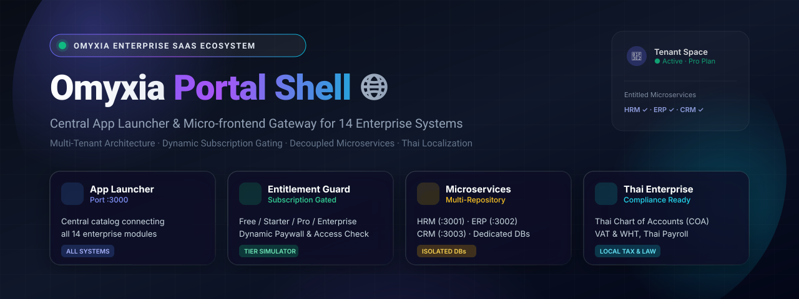
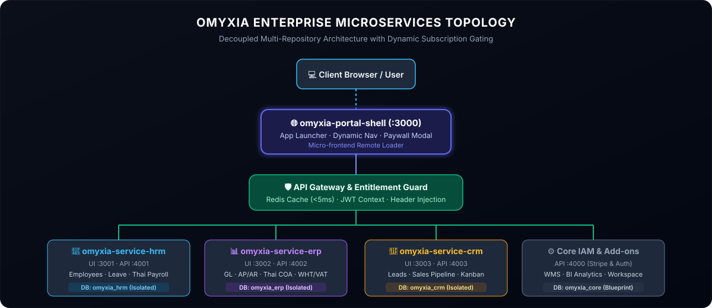
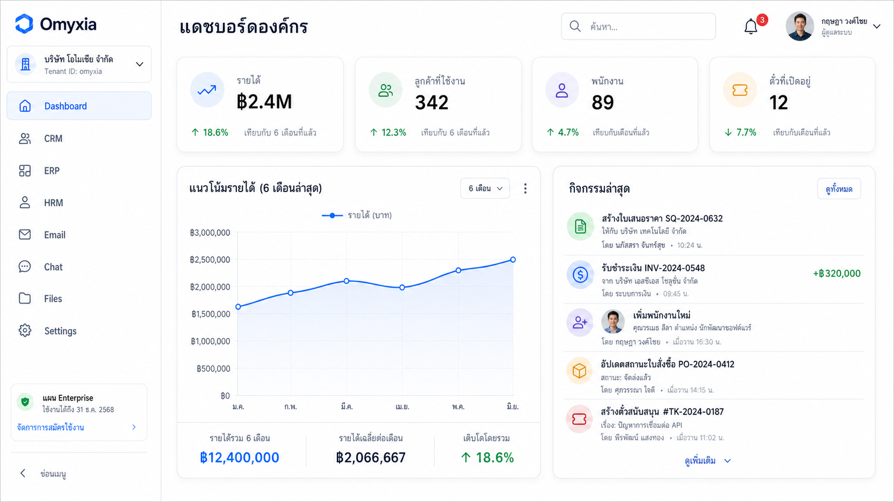
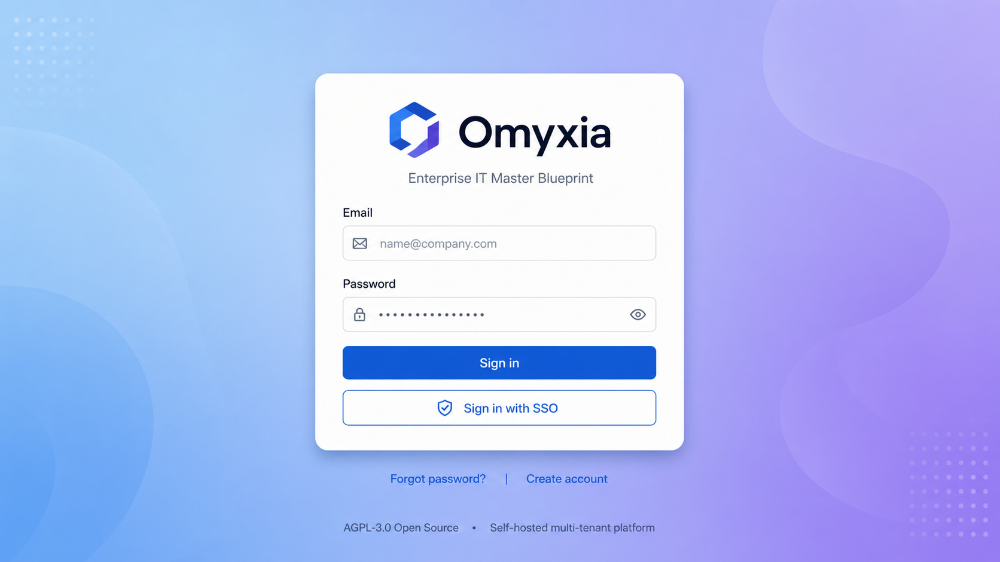
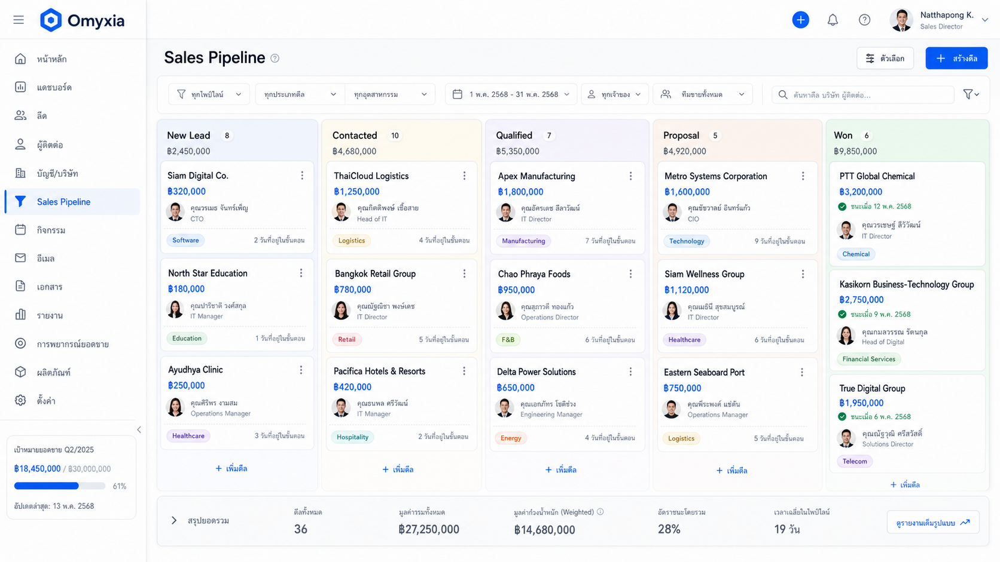
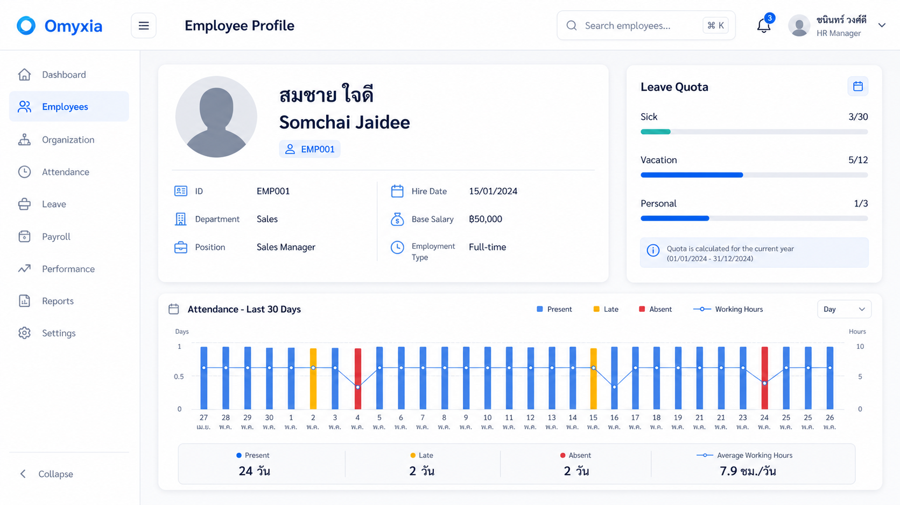

<p align="center">
  
</p>

<div align="center">

# 🌐 Omyxia Portal Shell & Central App Launcher

### Central Host Application for the Omyxia Enterprise Microservices Ecosystem

[]()
[]()
[]()
[]()
[]()
[]()

**Omyxia Portal Shell** is the central entry point and unified launcher for all 14 enterprise services in the [open-uppu](https://github.com/open-uppu) organization. It delivers dynamic tenant subscription entitlement gating, real-time plan simulation, upgrade paywalls, and embedded micro-frontend remote mounting.

[🏛️ Architecture](#-system-architecture) ·
[📸 UI Screenshots](#-visual-interface-showcase) ·
[🚀 Microservices Repos](#-live-microservices-roster) ·
[💡 Features](#-key-features) ·
[🛠️ Local Setup](#-local-development)

</div>

---

## 🏛️ System Architecture

<p align="center">
  
</p>

```
                          [ Client Browser ]
                                   │
                                   ▼
         [ Central Portal Shell :3000 ] (open-uppu/omyxia-portal-shell)
         ├── App Launcher Grid (14 Enterprise Services Catalog)
         ├── Dynamic Entitlement Gate (FREE / STARTER / PRO / ENTERPRISE)
         ├── Real-time Plan Simulator & Upgrade Paywall Modal
         └── Micro-frontend Host Container (Module Federation)
                                   │
       ┌───────────────────────────┼───────────────────────────┐
       ▼                           ▼                           ▼
[ HRM Microservice ]       [ ERP Microservice ]        [ CRM Microservice ]
:3001 UI / :4001 API       :3002 UI / :4002 API        :3003 UI / :4003 API
Database: omyxia_hrm       Database: omyxia_erp        Database: omyxia_crm
(omyxia-service-hrm)       (omyxia-service-erp)        (omyxia-service-crm)
```

---

## 📸 Visual Interface Showcase

<table align="center" width="100%">
  <tr>
    <td align="center" width="50%">
      <br>
      <sub><b>📊 Multi-Tenant BI Dashboard &amp; Analytics</b> — Real-time KPIs, revenue trend, and tenant switcher</sub>
    </td>
    <td align="center" width="50%">
      <br>
      <sub><b>🔐 Enterprise Identity &amp; Login</b> — Multi-tenant authentication, MFA, and SSO</sub>
    </td>
  </tr>
  <tr>
    <td align="center" width="50%">
      <br>
      <sub><b>🎯 CRM Sales Pipeline</b> — Visual Kanban stages, lead qualification, and activities</sub>
    </td>
    <td align="center" width="50%">
      <br>
      <sub><b>👥 HRM &amp; Payroll Management</b> — Employee contracts, attendance, leave quotas, and Thai payroll</sub>
    </td>
  </tr>
</table>

---

## 🚀 Live Microservices Roster

Each service operates in its own Git repository with independent CI/CD pipelines, isolated database, and decoupled lifecycle:

| Microservice | GitHub Repository | Frontend | Backend | Isolated Database | Min Entitled Tier |
| :--- | :--- | :---: | :---: | :---: | :---: |
| **🌐 Central Shell** | [`open-uppu/omyxia-portal-shell`](https://github.com/open-uppu/omyxia-portal-shell) | `:3000` | Host | Portal Cache | `FREE` |
| **👥 HRM & Payroll** | [`open-uppu/omyxia-service-hrm`](https://github.com/open-uppu/omyxia-service-hrm) | `:3001` | `:4001` | `omyxia_hrm` (PostgreSQL) | `STARTER` |
| **📊 ERP & Accounting** | [`open-uppu/omyxia-service-erp`](https://github.com/open-uppu/omyxia-service-erp) | `:3002` | `:4002` | `omyxia_erp` (PostgreSQL) | `PRO` |
| **🎯 CRM & Pipeline** | [`open-uppu/omyxia-service-crm`](https://github.com/open-uppu/omyxia-service-crm) | `:3003` | `:4003` | `omyxia_crm` (PostgreSQL) | `STARTER` |
| **🏛️ Core Blueprint** | [`open-uppu/Omyxia`](https://github.com/open-uppu/Omyxia) | `:3000` | `:4000` | Monolith Baseline | All Tiers |

---

## 💡 Key Features

1. **App Launcher Grid (14 Services):**
   * Central dashboard listing all 14 enterprise services across HR, Finance, Operations, Collaboration, and Governance.
   * Dynamically unlocks entitled apps with a direct **"เปิดใช้งานแอป (Launch App)"** button.
   * Locks unentitled apps with a **"ล็อก - ดูเงื่อนไข (Locked)"** badge and triggers the Upgrade Paywall Modal.
2. **Interactive Plan Simulator:**
   * Switch between `FREE`, `STARTER`, `PRO`, and `ENTERPRISE` tiers in real-time on the navbar to simulate tenant subscription entitlements.
3. **Upgrade Paywall Modal:**
   * Contextual upgrade prompts recommending the exact subscription plan or standalone add-on required.
4. **Workspace Embedded Preview:**
   * Embedded live preview & standalone tabs for decoupled microservices (`hrm` on 3001, `erp` on 3002, `crm` on 3003).

---

## 🛠️ Local Development

### 1. Run Multi-Service Databases & Redis
```bash
# Starts separate PostgreSQL databases for core, hrm, erp, crm and Redis cache
docker compose -f docker-compose.microservices.yml up -d
```

### 2. Start Portal Shell
```bash
# Install dependencies
pnpm install

# Run Portal Shell in development mode
pnpm dev
# 🌐 Access at http://localhost:3000
```

---

<p align="center">
  <sub>Built with ❤️ by the Omyxia Architecture &amp; Engineering Team · Licensed under AGPL-3.0</sub>
</p>
